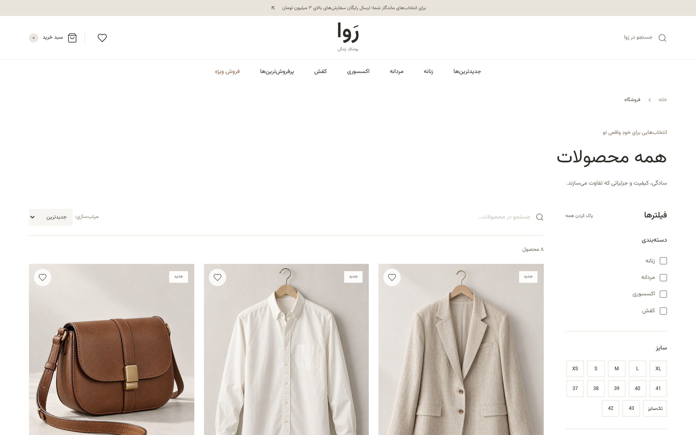
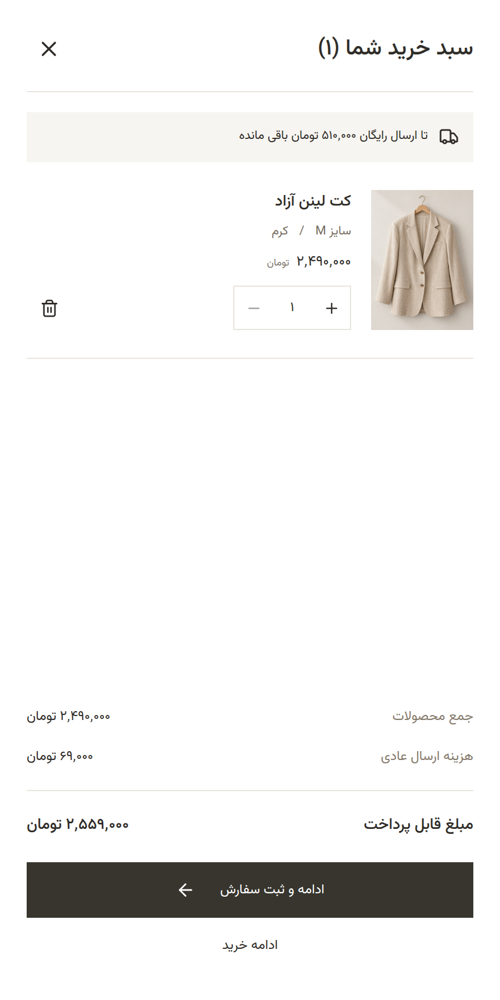
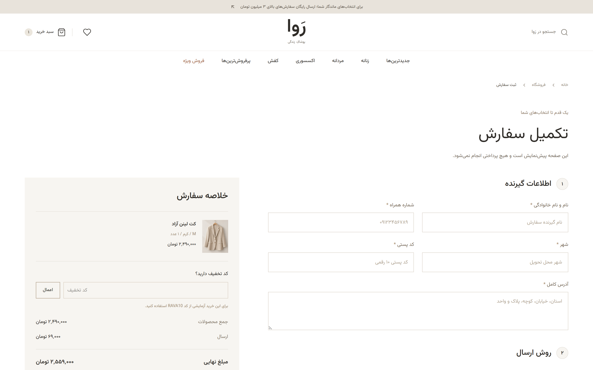
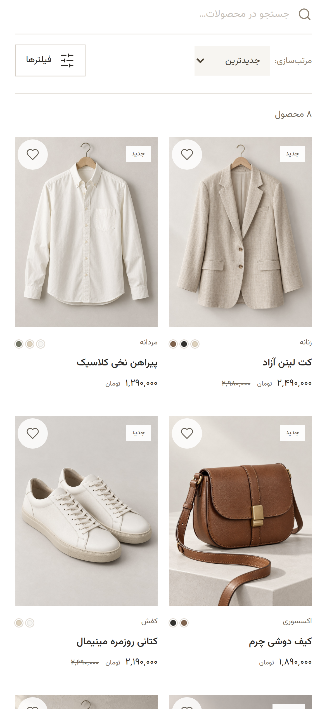

# رَوا (Rava) — Persian Fashion Storefront

A responsive, **RTL-first** e-commerce storefront for a minimal Persian fashion brand, built with **React 19 + TypeScript + Vite + Tailwind CSS 4**. All storefront copy is Persian, prices use Persian digits and تومان, and the entire UI is designed right-to-left from the ground up — not mirrored as an afterthought.


## Features

- **Editorial home page** — seasonal hero, category links, filterable new arrivals, best sellers, and newsletter preview.
- **Product catalog** (`/products`) — URL-backed search plus category, size, color, price, stock, new-arrival, sale, and favorites filters; four sort modes; mobile filter drawer.
- **Product detail** (`/products/:id`) — touch-friendly gallery, close-up and full-screen preview, size guide, variant validation, quantity selector, favorites, accordions, and related products.
- **Cart drawer** — variant-aware quantities, free-shipping threshold, totals, `localStorage` persistence, and full keyboard accessibility.
- **Checkout** (`/checkout`) — Persian/Arabic digit-aware form validation, delivery options, discount code `RAVA10`, order summary, and a local success confirmation.

## Screenshots

| Catalog with filters | Product detail |
| --- | --- |
|  |  |

| Cart drawer | Checkout |
| --- | --- |
|  |  |

<p>
  
  
</p>

## Tech Stack

| Layer | Choice |
| --- | --- |
| Framework | React 19 + TypeScript (strict) |
| Build | Vite 7 |
| Styling | Tailwind CSS 4 |
| Routing | React Router 7 (lazy-loaded secondary pages) |
| Animation | Framer Motion |
| Icons | Lucide |
| Font | Vazirmatn (bundled locally) |
| Tests | Vitest |

## Getting Started

Requires Node.js 22.12+ (developed with Node 24).

```sh
npm install
npm run dev
```

Open the local address printed by Vite (usually `http://localhost:5173`).

```sh
npm run build    # strict TypeScript check and production bundle
npm run preview  # serve the production bundle
npm test         # cart, filtering, shipping, and validation tests
```

For deployment, serve `dist/` and rewrite non-asset requests to `index.html` so direct visits to nested routes work.

## Architecture

```
src/
├── types/       # catalog and cart contracts
├── data/        # typed product catalog
├── providers/   # CartProvider: cart + favorites state
├── utils/       # independently tested business rules
├── components/  # reusable UI and feature components
├── pages/       # route-level pages (secondary pages lazy loaded)
├── layouts/
└── routes/
```

Stored cart data is validated and re-resolved against current catalog prices on hydration. All photographs are project-local JPEGs in `public/images/` and Vazirmatn is bundled, so no third-party image or font host is contacted at runtime. Image provenance and the generation prompt set are documented in `ASSETS.md`.

## Accessibility

Semantic RTL markup, visible focus states, labeled inputs and icons, modal focus trapping and restoration, Escape dismissal, background inertness, live cart feedback, reduced-motion support, and responsive controls. Automated business-rule tests complement interactive desktop/mobile browser checks; they are not a formal accessibility certification.

## Preview Boundaries

This is a complete **frontend preview**. Checkout, newsletter, ratings, inventory, delivery promises, and order numbers are demonstration data — no payment is collected, no email is sent, and no physical order is created. Customer form data stays in component memory; only cart selections and favorites are stored in `localStorage`.

Before connecting a real storefront: replace catalog data and imagery with actual inventory, verify product dimensions and size guides, and implement server-authoritative pricing, stock validation, order persistence, newsletter delivery, and payment integration.
